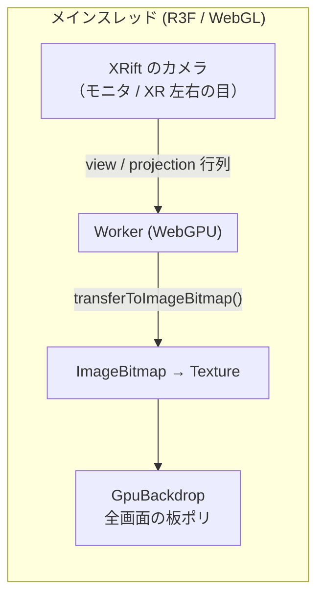

# Abyssal Garden — XRift world

[Noniv/abyssal-garden](https://github.com/Noniv/abyssal-garden)（MIT）を
XRift のワールドとして動かすためのフォークです。

海中世界はすべて **raw WebGPU（WGSL）** で描かれています（three.js も
Babylon も使っていません）。XRift のワールドは React Three Fiber = WebGL の
キャンバスなので、WebGPU の描画は **Worker の中で行い、結果を
[`@webxr-jp/webgpu-view`](https://www.npmjs.com/package/@webxr-jp/webgpu-view)
で R3F の背景として表示**しています。



- **モニタ**: 画面全体を覆う板ポリに、ワールドのカメラから描いた 1 枚を貼る
- **XR**: 左右の目ぶんを 1 フレームで横に並べて描き（アトラス）、
  目ごとのビューポートに表示する（`@webxr-jp/webgpu-view` が自動で切り替える）
- カメラ行列は毎フレーム XRift 側から渡り、歩くと海中の視点も動く
- カメラは海底の岩にめり込まない（上流の衝突グリッドをそのまま使って押し出す）
- WebGPU が使えない環境では背景が出ないだけで、ワールド自体は起動する

## ファイル構成

```
src/
├── abyssal/
│   ├── engine.js         # 上流の quality / math / shaders / world をまとめたもの
│   ├── renderer.js       # 上流の main.js を Worker 用に書き換えたもの
│   └── LICENSE-abyssal   # 上流の MIT ライセンス
├── worker/
│   └── abyssal.worker.ts # webgpu-view の Worker プロトコル（init/resize/frame/dispose）
├── components/
│   └── AbyssalBackdrop/  # GpuBackdrop のラッパー
├── World.tsx             # スポーン・見えない床・読み込み表示
└── dev.tsx               # ローカル開発用エントリ
```

### 上流との差分

`engine.js` は上流の `source/src/{quality,math,shaders,world}.js`
（[a596354](https://github.com/Noniv/abyssal-garden/commit/a596354)）を
そのまま連結したものです。変更点は 2 つだけです。

1. 先頭の品質レベル（上流は `localStorage` / `matchMedia` から決めていましたが、
   ここでは Worker が `globalThis.__ABYSSAL_QUALITY__` で渡します）
2. `W_POST` のフラグメントシェーダで、XR のアトラス（左右の目を横並び）に
   描くときの x オフセットを `g.mis.w` から引くようにした

それ以外の WGSL とワールド生成は上流のままです。

`renderer.js` は `main.js` から次のものを置き換えています。

| 上流 | このフォーク |
| --- | --- |
| メニュー・ローディングバー・ポインタロック・タッチ操作 | なし（XRift の移動を使う） |
| `requestAnimationFrame` で描画 | `frame` メッセージで描画 |
| カメラを WASD で泳ぐ | XRift のカメラ行列から毎フレーム決める |
| 1 視点 | 1〜2 視点（XR は左右を横並びに描く） |
| 動的解像度 | 描画距離 `det` の自動調整（画像サイズはホストが決めるため） |
| 泳ぎの当たり判定 | カメラを岩から押し出すだけ（歩行は XRift 側） |
| 効果音（Web Audio） | 未移植（下記「制限」参照） |

ワールド生成・シェーダ・パス（影・光の筋・ブルーム・水面）は上流のままです。

## 開発

```bash
npm install
npm run dev        # http://localhost:5173/
npm run typecheck
npm run build      # dist/ に Module Federation の成果物
npx xrift check world
npx xrift upload   # XRift にアップロード（要 xrift login）
```

ブラウザは **WebGPU が使える Chrome / Edge** が必要です。
`npm run dev` は `http://localhost` なので secure context の条件を満たします。

ヘッドセットで試すときは `npm run dev -- --host` で LAN に公開し（HTTPS になります）、
実機のブラウザで `https://<PCのIP>:5173/` を開いて右上の **Enter VR** を押します。
自己署名証明書の警告は一度許可してください。

### デバッグ用の URL クエリ

| クエリ | 意味 |
| --- | --- |
| `?quality=0` / `1` / `2` | High / Medium / Low（未指定は端末から自動） |
| `?maxWidth=960` | 1 視点ぶんの描画解像度の上限（既定 モニタ 1280 / XR 640） |
| `?maxFps=30` | Worker の最大描画頻度（既定 60） |
| `?debug=1` | ready / fps をコンソールに出す |
| `?profile=1` | 1 秒ごとの描画統計（`[abyssal] stats {...}`） |
| `?off=1` | 背景を止める（切り分け用。ワールド生成は走る） |
| `?stereo=1` | モニタでも左右 2 視点（アトラスの確認用） |

## 制限

- **視差は出ません。** `GpuBackdrop` は「カメラに追従する背景」なので、
  メインシーンのオブジェクトとの前後関係は常に「背景が奥」になります。
  移動・回転に応じて海中の視点は動きますが、立体視の奥行きは画像 1 枚ぶんです。
  メインシーンとピクセル単位で合成したい場合は
  `@webxr-jp/webgpu-view/experimental` の `DepthComposite` があります（XR 非対応）。
- **VR はローカルでも確認できます。** `npm run dev -- --host` で開いたページの右上に
  「Enter VR」ボタンがあります（`src/components/EnterVrButton`）。本番ビルドには入りません。
  XR では左右 2 視点を 1 枚のアトラスに描くため、既定を Low + 640px/eye にしています
  （`?quality=` / `?maxWidth=` で上書き可）。PICO 4 Ultra では 640/eye で 20fps 前後、
  320/eye で 25〜30fps、描画距離 `det` が 0.5 まで落ちた状態での値です。
  XR のフレーム間隔は「Worker の GPU 時間＋ImageBitmap の受け渡し」で決まり、
  背景を止めると 72fps で回るので、重さはほぼ背景側です。
- **効果音は入っていません。** 上流の Web Audio の音響（`source/src/audio.js`）は
  移植していません。
- **Worker は blob（`?worker&inline`）で起動します。** XRift はワールドを
  `assets.xrift.net`、ページを `app.xrift.net` で配信するため、別ファイルの Worker は
  「別オリジン」として `SecurityError` になります（URL をサブパスに合わせても同じ）。
  そこで `worker.rollupOptions.output.inlineDynamicImports` で 1 ファイルにまとめ、
  blob から起動しています。このため `xrift.json` の `permissions.allowedCodeRules` に
  `no-javascript-blob` と `no-network-without-permission` を宣言しています
  （入室時に同意画面が出ます）。
- 上流の「動的解像度」の代わりに、GPU 時間を見て描画距離 `det` を
  0.5〜1.0 で自動調整します（`[abyssal] gpu ... / draw distance ...`）。
  手元の Mac（Apple Silicon, Chrome）では High / 1280x938 で
  `det` が 0.7〜0.8 に落ち着き、**60 fps**（GPU 13〜16 ms）でした。
  GPU 時間はマシンの負荷で大きく変わるので、`?profile=1` で確認してください。

## ライセンス

このフォークは上流と同じ **MIT** です（`LICENSE`）。
`src/abyssal/` 以下の上流コードは `src/abyssal/LICENSE-abyssal` の条件で利用しています。
